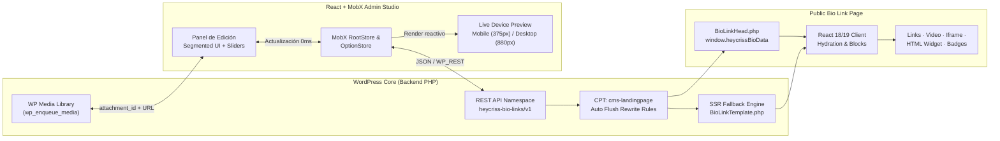

<div align="center">

<!-- Animated Editorial Hero Banner -->
<a href="https://heycriss.dev/WP-LinkBio">
  
</a>

<br />

<!-- Animated Typing Headline -->
<a href="https://heycriss.dev/WP-LinkBio">
  
</a>

<br />

<!-- Badges -->
[](https://heycriss.dev/WP-LinkBio)
[](https://wordpress.org)
[](https://php.net)
[](https://react.dev)
[](./LICENSE)

<p align="center">
  <a href="https://heycriss.dev/WP-LinkBio"><strong>Sitio Oficial</strong></a> ·
  <a href="#-características-principales"><strong>Características</strong></a> ·
  <a href="#-arquitectura-del-sistema"><strong>Arquitectura</strong></a> ·
  <a href="#-instalación-rápida"><strong>Instalación</strong></a> ·
  <a href="#-bloques-interactivos-y-embeds"><strong>Bloques &amp; Widgets</strong></a> ·
  <a href="#-api-y-hooks-para-desarrolladores"><strong>API &amp; Hooks</strong></a>
</p>

</div>

---

## Visión General

**HeyCriss Bio Links** es un plugin Open Source de nivel estudio para **WordPress**, diseñado bajo principios de **diseño editorial, estilo Bento y minimalismo moderno**. Permite crear, gestionar y analizar páginas *Link in Bio* de alto rendimiento alojadas 100% en tu propia infraestructura de WordPress, sin comisiones mensuales, sin marcas de agua obligatorias y sin depender de servicios SaaS externos.

> [!IMPORTANT]
> **Filosofía Cero Paywalls & Cero "AI Slop":** Todas las funciones avanzadas —analíticas locales, fondos de video en alta definición, insignias de verificación, bloques de Iframe/HTML personalizados, formularios, integraciones multimedia y las 6 plantillas de estudio— están **100% desbloqueadas de fábrica**.

<br />

<div align="center">
  
</div>

---

## Características Principales

<table>
  <thead>
    <tr>
      <th width="28%">Módulo</th>
      <th width="36%">Capacidades Técnicas</th>
      <th width="36%">Ventaja Arquitectónica</th>
    </tr>
  </thead>
  <tbody>
    <tr>
      <td><strong>Estudio Reactivo en Tiempo Real</strong></td>
      <td>
        Sincronización instantánea con <code>MobX</code> + <code>React 18/19</code>. Conmutador rápido entre vista <strong>Mobile (375×812)</strong> y <strong>Desktop/Tablet (880×680)</strong>.
      </td>
      <td>
        Edición fluida sin recargas de página ni parpadeos en el mockup interactivo.
      </td>
    </tr>
    <tr>
      <td><strong>Motor Multimedia Nativo (<code>wp.media</code>)</strong></td>
      <td>
        Selector integrado con la librería de medios de WordPress para avatares, portadas e imágenes de fondo o <strong>videos en bucle (<code>MP4</code> / <code>WebM</code>)</strong>.
      </td>
      <td>
        Persistencia de <code>attachment_id</code> + URL directa y control deslizante de opacidad de superposición (<code>0% – 85%</code>) para garantizar contraste <strong>WCAG AA</strong>.
      </td>
    </tr>
    <tr>
      <td><strong>Insignias de Perfil &amp; Etiquetas de Rol</strong></td>
      <td>
        Badges vectoriales SVG personalizables (<em>Verificado</em>, <em>Creador</em>, <em>Oficial</em>, <em>Estrella</em>) con selector de color y <em>Role Pill</em> editorial junto al nombre.
      </td>
      <td>
        Jerarquía visual limpia y autoridad de marca sin depender de imágenes externas.
      </td>
    </tr>
    <tr>
      <td><strong>Bloques de Iframe &amp; HTML Micro-Widgets</strong></td>
      <td>
        Soporte nativo para insertar <code>&lt;iframe&gt;</code> responsivos (Spotify, Mapas, Typeform, Calendly, YouTube) y widgets HTML/CSS/JS aislados.
      </td>
      <td>
        Sanitización de seguridad en backend con <code>wp_kses()</code> y renderizado aislado en <code>sandbox</code> para proteger el DOM principal.
      </td>
    </tr>
    <tr>
      <td><strong>Analíticas Locales Autohospedadas</strong></td>
      <td>
        Métricas de vistas, clics por enlace, CTR, ubicaciones, dispositivos y referrers almacenadas directamente en tablas locales de WordPress.
      </td>
      <td>
        Cumplimiento de privacidad (GDPR-friendly) sin enviar tráfico de tus visitantes a servidores de terceros.
      </td>
    </tr>
    <tr>
      <td><strong>Renderizado Híbrido SSR + Hidratación</strong></td>
      <td>
        Plantilla PHP con fallback semántico instantáneo (<code>BioLinkTemplate.php</code>) + hidratación cliente y auto-flush de permalinks.
      </td>
      <td>
        Cero pantallas en blanco, carga inmediata en conexiones móviles y SEO/OpenGraph completo desde el primer byte.
      </td>
    </tr>
  </tbody>
</table>

---

## Sistema de Diseño y Plantillas Editoriales

Todas las plantillas incluidas han sido diseñadas bajo una cuadrícula espacial de `8px`, radios armónicos y contrastes verificados (**WCAG AA**):

| Preset ID | Nombre del Tema | Estética Visual | Paleta Base | Tipografía |
| :--- | :--- | :--- | :--- | :--- |
| `nila` | **Minimal Studio** | Claridad suiza, bordes nítidos y alto contraste sobre blanco cálido | `#FAFAFA` · `#18181B` | `Inter` |
| `louden` | **Dark Obsidian** | Modo oscuro profundo con superficies de grafito y acentos puros | `#09090B` · `#27272A` | `Plus Jakarta Sans` |
| `anel` | **Editorial Serif** | Inspiración en revistas impresas sobre papel piedra cálido | `#F5F5F0` · `#1C1917` | `Playfair Display` |
| `botanical` | **Botanical Craft** | Tonos bosque orgánicos con acentos esmeralda suaves | `#1C2826` · `#ECFDF5` | `DM Sans` |
| `nordic` | **Nordic Slate** | Minimalismo escandinavo con grises minerales equilibrados | `#F4F4F6` · `#18181B` | `Inter` |
| `midnight` | **Midnight Pro** | Azul noche técnico con tarjetas de alto contraste | `#090D16` · `#F8FAFC` | `Space Grotesk` |

---

## Arquitectura del Sistema



---


## Bloques Interactivos y Embeds

Además de los bloques sociales y multimedia clásicos (**Enlaces, YouTube, Spotify, SoundCloud, Vimeo, TikTok, Twitch, Podcast, Calendly, Contacto, Documentos, Donaciones, Galería, Blog, Texto y Deslizadores**), **HeyCriss Bio Links** incorpora dos bloques avanzados:

<details open>
<summary><strong>1. Bloque de Iframe / Embed Personalizado (<code>type: "Iframe"</code>)</strong></summary>
<br />

Permite incrustar cualquier widget interactivo externo pegando directamente la URL o el código `<iframe>` completo:
- **Extracción automática de `src`:** Acepta tanto URLs directas (`https://...`) como fragmentos HTML `<iframe src="..."></iframe>`.
- **Altura adaptable:** Control numérico de altura entre `120px` y `1200px` (por defecto `360px`).
- **Seguridad en Backend:** Validado mediante `BioLink::sanitizeIframeContent()` con lista blanca de atributos seguros (`src`, `width`, `height`, `frameborder`, `allow`, `allowfullscreen`, `loading`, `sandbox`).

</details>

<details>
<summary><strong>2. Bloque de Micro-Widget HTML / JS (<code>type: "HtmlWidget"</code>)</strong></summary>
<br />

Ideal para insertar calculadoras ligeras, widgets de reservas, tablas de precios o tarjetas HTML/CSS a medida:
- **Aislamiento de Estilos:** Se renderiza dentro de un contenedor `<iframe sandbox="allow-scripts allow-same-origin allow-forms allow-popups" srcDoc="...">` con tipografía base `Inter` preconfigurada.
- **Sin colisiones CSS:** El código personalizado nunca rompe ni altera las hojas de estilo del Bio Link ni del tema activo de WordPress.

</details>

<details>
<summary><strong>3. Uso mediante Shortcode en cualquier Página o Entrada</strong></summary>
<br />

También puedes incrustar cualquier página Bio Link dentro de una página estándar de WordPress, Gutenberg o Elementor usando su ID:

```text
[heycriss-bio-links id="123"]
```
*(Mantiene retrocompatibilidad automática con `[social-lite id="123"]`).*

</details>

---

## Estructura del Directorio

```text
heycriss-bio-links/
├── assets/
│   ├── github-hero.svg              # Banner animado vectorial para el repositorio
│   └── github-features-bento.svg    # Tarjetas Bento animadas de especificaciones
├── inc/
│   ├── Assets.php                   # Encolado React 18/19, wp.media y localización JS
│   ├── Core.php                     # Inicialización del plugin y servicios REST
│   ├── base/
│   │   ├── CPT.php                  # Registro de cms-landingpage y auto-flush de permalinks
│   │   └── others/cachebuster.php   # Hashes MD5 + filemtime para invalidación de caché
│   ├── overrides/
│   │   └── BioLink.php              # Sanitización wp_kses para Iframes y endpoints Pro libres
│   └── view/
│       ├── bio/BioLinkHead.php      # Metadatos OpenGraph e inyección de window.heycrissBioData
│       ├── bio/BioLinkTemplate.php  # Plantilla pública con fallback SSR en PHP puro
│       └── menu/Page.php            # Contenedor del estudio en wp-admin
├── public/
│   └── dist/
│       ├── admin.js                 # Estudio de administración React + MobX + WP Media
│       ├── frontend.js              # Hidratación del Bio Link público y bloques interactivos
│       ├── bio-link.css             # Sistema de diseño editorial, variables CSS y utilidades
│       ├── admin.css                # Estilos del panel de administración
│       └── frontend.css             # Estilos de la vista pública
├── index.php                        # Punto de entrada del plugin (v2.0.1)
└── README.md                        # Documentación del repositorio
```

---

## API y Hooks para Desarrolladores

### Variables Globales en Frontend y Admin

El plugin inyecta de forma síncrona el estado inicial para evitar condiciones de carrera con plugins de caché o diferido de scripts (WP Rocket, LiteSpeed, Autoptimize):

```js
// Disponible tanto en wp-admin como en la vista pública del Bio Link
console.log(window.heycrissBioData);
console.log(window.heycrissBioLinks);
```

### Filtros de WordPress (`add_filter`)

```php
// Personalizar endpoints de Custom Post Types adicionales para el bloque de Blog
add_filter('heycriss_bio_links_blog_cpt_endpoints', function (array $endpoints) {
    $endpoints['portfolio'] = [
        'slug'  => 'portfolio',
        'label' => 'Portafolio',
        'rest'  => rest_url('wp/v2/portfolio'),
    ];
    return $endpoints;
});
```

---

## Licencia y Créditos

Distribuido bajo la licencia **GNU General Public License v2.0 o posterior (`GPL-2.0-or-later`)**. Eres libre de usar, estudiar, modificar y redistribuir este software tanto en proyectos personales como comerciales.

<div align="center">
  <br />
  <p>
    Diseñado y mantenido con precisión por <strong><a href="https://heycriss.dev/WP-LinkBio">HeyCriss Labs</a></strong>
  </p>
  <p>
    <a href="https://heycriss.dev/WP-LinkBio"><code>heycriss.dev/WP-LinkBio</code></a>
  </p>
</div>
